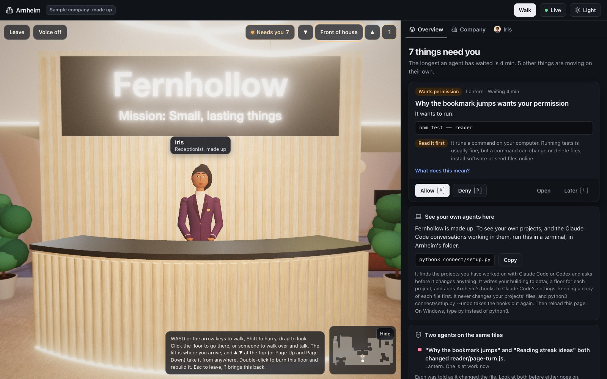

# Arnheim

Arnheim puts all your AI coding agents, Claude Code and Codex alike, in one building you can walk
through. It shows which one is waiting on you and lets you answer it there, proves whether the work
each one calls done really passes its checks, tells the next agent what the last one finished, and
warns you before your plan's limit runs out.


```bash
git clone https://github.com/allwhenlabs/arnheim && cd arnheim && python3 serve.py
```

It opens http://127.0.0.1:8740 in your browser. It needs Python 3.7 or newer and a current browser,
with nothing to install, and shows a made-up company until you add your own ([Start](#start) has the details).
The first start downloads the pictures for the photo-real look (52 MB) once; `python3 serve.py
--drawn` skips that and keeps the drawn look ([The photo-real look](#the-photo-real-look)).

Watch [the tour](https://youtu.be/KEkXY7dtImA), or [a talk with the receptionist](https://youtu.be/jA8PU7aNmJo).

## What it is


Your company as a building you can walk through and talk to. Each project is a floor, each kind of
work is a room, and the work lights up as it happens. The people inside are your agents at work:
walk up to one and ask how it's going. A receptionist at the front desk answers questions about the
whole company, and your assistant waits in your office at the top.

Arnheim shows the work and never does it. It reads plain files, or what your own page gives it, and
changes none of them. It is free and open, and never sold.

## Start

You need Python 3.7 or newer and a browser with WebGL 2 (any current Chrome, Edge, Firefox or
Safari). There is nothing to install. In this folder:

```bash
python3 serve.py
```

It opens http://127.0.0.1:8740 in your browser (`--no-browser` leaves that to you). It shows
Fernhollow, a made-up company, until you add your own: press **Connect my agents** on its welcome card
([Connect your agents](#connect-your-agents)). The first time, it downloads the photo-real
look's pictures before it opens ([The photo-real look](#the-photo-real-look)), and a one-minute tour
points out the floors, what waits on you and Walk (**Show the tour again**, in the ... menu, brings it back). When a
newer Arnheim is out on GitHub, the Needs you tab says so, with **Update now**.

To keep it running when you close the terminal, and have it start again each time you log in, run
`python3 serve.py --always` instead, once (on a Mac or Linux). `python3 serve.py --always off`
stops it and takes that out.

On a Mac, the Arnheim app does this without a terminal: it sits in the menu bar, starts Arnheim, opens
the page, and can start it each time you log in. For now you build it once with `mac/build.sh`
([docs/mac.md](docs/mac.md) says how, and how to open it the first time).

**From inside Claude Code.** Type these two lines in Claude Code, choosing **Install for you** when it
asks, then type `/arnheim:setup`:

```text
/plugin marketplace add allwhenlabs/arnheim
/plugin install arnheim@arnheim
```

It asks where to keep Arnheim, copies it there, starts it and opens the page where you connect your
agents, asking you before each change. `/arnheim:open` opens the page, and `/arnheim:status` says
whether it is running. In Codex, run `codex plugin marketplace add allwhenlabs/arnheim`, install
Arnheim from `/plugins`, and ask it to set up Arnheim in a new chat. Any other agent can do the
same if you paste in: "Set up Arnheim for me: follow
github.com/allwhenlabs/arnheim/blob/main/docs/agent-setup.md".

On Windows, run `py serve.py`. For another port, `python3 serve.py 8741`. On a Mac, the first
`python3` may offer to install Apple's command line tools, which bring Python: say yes. Arnheim has
been used on macOS in Chrome and Safari. On Linux (Ubuntu 24.04), its tests, setup, starting at login
and the voice have been run, but not yet the page in a Linux browser. Windows should work but hasn't
been tried.

## Walk through it



Press **Walk** to step inside, at the reception.

- **Move** with WASD or the arrow keys on a computer, or the stick on a phone. Drag to look round.
  Tap the floor to walk there.
- **Change floors** in the lift at the end of each floor's hall: walk in and pick a floor. Or use
  ▲ and ▼ beside the floor's name at the top (Page Up and Page Down on a keyboard), or tap the
  name for the list of floors. Your office is at the top, the shared machines are in the basement.
- **Open** anything by tapping it: a desk, a screen, a person.
- **Leave** with the Leave button or Esc.

A walk round goes like this. You start at reception: step into the ring in front of the
receptionist and ask what needs you. Take the lift to a floor lit blue, where work is going on.
Its rooms open onto the hall, and each agent at work has a ring beside them: step in, or tap them,
and ask how it's going. Then the lift again, to the next floor, or up to your office.

With reduced motion on, the camera keeps still and floors change at once. On a slow computer or
phone, add `?lite` to the address.

## The photo-real look

The building opens as if photographed: the floors, the lobby, the basement, your office and the
street outside, in the light of a measured sun. Its pictures (a 52 MB download, about 95 MB
unpacked) are made from the code in `studio/` with Blender, and are kept out of this repository so
it stays small. The first time `serve.py` starts, it downloads them once, from the release made for
this version of Arnheim, into a `baked/` folder here. It says how big they are before it starts and
shows how far it has got, then opens. The sample's receptionist and assistant are photo-real;
people you name and dress yourself are drawn in their own look.

With no internet, or if the download fails, the page opens in the drawn look and says why in one
line, under the building and in the terminal. `serve.py` tries again the next time it starts. A
download cut short never leaves half a `baked/` folder behind.

The drawn look is one switch away:

- add `?look=drawn` to the address: http://127.0.0.1:8740/?look=drawn
- or start with `python3 serve.py --drawn`, which opens in the drawn look and downloads nothing.

`?look=photo` asks for the photo-real look even when `serve.py` wouldn't choose it, for example
with floors you baked yourself (`studio/publish.py`).

To download the pictures yourself instead, in this folder:

```bash
curl -LO https://github.com/allwhenlabs/arnheim/releases/download/photo-real-3/baked.zip
unzip baked.zip
```

(On Windows: `curl.exe -LO` with the same address, then `tar -xf baked.zip`.)

## Talk to the people

Each person in the building has a ring of light on the floor beside them. Step into it and a
conversation opens, with no button to press. Type, or turn on **Voice** to speak and hear them
answer aloud ("Voice", below).

- **Your agents.** Someone sits at a desk or in a chair while work is being done, or while they
  wait for you. Tap them to walk up. Ask how it's going, what's next, or whether they need you. In
  the sample they answer from lines written for them in `sample/work.json`. Connected to Claude
  Code, they tell you what Claude last said, and with control on, what you say reaches the agent
  itself (below).
- **The receptionist**, at the front desk on a walk, and on their own page (tap them, or **Ask** them in the ... menu), knows the
  whole company (below). On a walk, talk to them out loud like anyone else: turn on Voice, step
  into their ring and ask.
- **Your assistant**, at their own desk in your office, if you have one. In the sample they answer
  as the receptionist does; your own page can give them their own answers.
- **Each floor's lead**, standing a few steps from the lift on every project floor, clear of the
  doorways and the ways people walk. Walking across their ring on your way somewhere else starts
  nothing: stop on it, or walk up to them, to talk. They know that one project in
  depth: who is working on it and what each last said, what waits on you there, its goals, open
  work, checks and spending. Ask **"where are we?"**, **"what's new?"** (since you last asked them,
  with how the agents answered what you passed on) or **"who's working?"**. Say **"tell them to test
  it on the spare laptop"** and, with control on, it goes to the agent at work there: with several,
  they ask which; with none, they offer to start one. Anything that can't be taken back (merging,
  publishing, deleting, paying) is read back first and goes only when you say "send it". Name them
  and choose their faces in `company.json` ("Make it yours", below).

  They **report back**. Once what you had them pass on is done, stuck or waiting on you, they tell you
  the next time you talk, without being asked: "You asked the one on the bookmark fix to test it on
  the spare laptop. It's done, and proven: the tests passed after its last change." What needs you
  comes first. Each piece of news is told once; after "done", only news of its checks follows. While
  you are with them, or with the receptionist (who says whose news it is), they speak up once it
  happens and nobody is talking. What you passed on is kept in that browser for two days.

Your office also holds your notes: the newest eight hang in its library. Tap one, or stand in its
light, to read it.

A Goals room with no goals yet has a bare flagpole (a blank card, in the photo look). Stand by it
and say **"the goal is ..."**, or type it in the talk box: it is read back, and a yes puts the flag
up. Changed your mind? Say the new goal instead, and that one is read back. Or tap the flagpole and
write it in the form. Arnheim's own site keeps a goal set this way only while the tab is open: to
keep it, add it to your `work.json` ([docs/data.md](docs/data.md)). A Code room with nothing to
review says so.

## Talk from any screen

**Talk**, at the top of every screen, opens a small panel where you talk, out loud or typed, without
walking: to the receptionist, your assistant or any floor's lead. On a floor's page it starts with
that floor's lead, whose card at the top of the page says where the project stands.

- **"Give me the round"**: every floor's lead in turn, a line each in their own voice, those with
  something waiting on you first: what came of what you asked, what finished, who is at work and what
  waits on you. The quiet floors are named together at the end. Then say a project's name, or **"more
  on Tidepool"**, to talk to its lead.
- **"How's Tidepool doing?"** puts you through to Tidepool's lead, who answers. **"Talk to the
  receptionist"** takes you back.
- **"Take me to Lantern"**, **"show me the work room on Kitefield"**, **"go home"** or **"back"**:
  the page goes there.
- **"Allow"**: the request waiting for your permission is read back to you, with how careful to be.
  Only then does "allow" or "deny" answer it, and only that one, within a minute. **"Next"** reads
  the next. Anything that may touch something private (a key, a login, a hidden file) is never
  answered by voice: it opens on the screen for you.

**Cut in by talking**: start speaking while someone is talking and they stop at once and listen to
what you say. It knows how loud each word it plays is, and listens for a voice well above what comes
back from your speakers, held for about a word, so their own voice (soft or loud) or a cough shouldn't
stop them. If a noisy room does, switch it off.

Each of these is a switch, in the panel (the sliders button) and in Settings under
Switches: talk from any screen, a lead on each floor, answering requests by voice, leads reporting
back, and cutting in by talking. They're kept in that browser. A company can set its own starting point in `company.json`, such as `"features":
{ "leads": false }`.

### What the receptionist knows, and what they can do

Everything they know comes from your own files: `company.json` and `work.json`, and the feeds you
connect ([docs/connect.md](docs/connect.md)). They match the words of your question to what those
files say. There is no AI and nothing leaves your computer, and when the files don't say, they say
they don't know. Switch on the brain, and they answer anything with Claude ("Talk about anything",
below).

- **Ask them** what needs you, what's running, what's happening on a floor, what a room is for and
  what's in it, about goals, pull requests, websites, email and machines, who runs the company,
  or what the colours mean.
- **Take me there**: an answer about something has a link that takes you to it.
- **Show me round**: in the panel, they take you round the building, floor by floor.
- **"Remind me to ..."** adds a task. The page Arnheim comes with keeps it in that browser tab
  only.
- **"Get someone to fix the login bug on Lantern"** (with control on) starts an agent on that floor,
  once you say "start it", with a brief that says what counts as done; with no floor named, they ask
  which. The building turns to the room where it sits down.
- **"Remember that ..."** adds a decision to the company's memory, which every agent is told as it
  starts ("Connect your agents", below). **"What have we decided?"** reads it back.
- **"What happened yesterday?"**, **"Who changed bookmark.js?"** or **"How was the week?"**: they
  answer from the building's week of history, and **"How long have the agents waited on me?"** from
  how long each waited.
- **"How do I ship a new build?"**: if the company has a how-to for it, they point to it on the
  Library's shelf. **"Can I undo what the agent did?"** lists the restore points.
- **"What's waiting on me?"** reads out everything that waits on you, from every agent and your own
  tasks, most urgent first. With control on, **"allow all the reads"** lets every agent waiting to
  read an ordinary file go ahead; searches, and anything that looks private, each need an answer.
- **Talk out loud** on a walk: with Voice on, just speak in their ring, and they answer aloud. In
  the panel, **Read aloud** has them speak their answers.

They never merge, publish, run jobs or sign in. A page of your own can teach them more words and
topics, or give them answers of its own ([docs/embed.md](docs/embed.md)).

## Make it yours

`python3 connect/setup.py` makes your company for you, a floor for each of your projects ("Connect
your agents", below). To write it yourself, your company goes in a folder called `data`, beside
`sample`:

```bash
mkdir data
cp sample/*.json data/
```

(On Windows: `mkdir data`, then `copy sample\*.json data`.) Change the copies and reload the page.
Git ignores `data/`, so your files stay on your computer.

- `company.json` is the map: your company's name and mission, a floor for each project with its
  rooms, the founder (you), the receptionist and your assistant. Take out the `"sample"` line,
  which marks a company as made up.
- `work.json` is what is going on: tasks, goals, conversations, pull requests, websites,
  machines. Empty the `story` at the end (`"story": []`): it only makes the sample move.
- `notes.json` is your notes, for your office. Optional.

[docs/data.md](docs/data.md) lists every field. If a file has a mistake, the page says which file
and what is wrong.

### Name them and choose their faces

The receptionist and your assistant are yours to name, dress and give a voice, in
`company.json`:

```json
"receptionist": { "name": "Iris", "voice": "af_heart",
  "look": { "skin": "#a26b48", "hair": "#2b1d18", "coat": "#5b3b5e" } },
"assistant": { "name": "Wren", "title": "Your assistant", "voice": "bf_emma",
  "look": { "style": "bun", "hair": "#5a3926", "coat": "#a8752b" } }
```

`look` takes colours for skin, hair, lips, coat, shirt and trousers, a hair style (`bun`, `braids`
or the default swept cut), a round face, and touches such as a round collar, a brooch and
earrings. Anything you leave out keeps the default. Without an `assistant`, your office has none.

Each project floor's lead is named the same way, on the floor in `company.json`: `"lead": { "name":
"Juno", "voice": "af_nicole" }`. Without a name they are simply that floor's lead, and `"lead":
false` leaves a floor without one ([docs/data.md](docs/data.md)).

## Connect your agents

On the page, on your own computer, press **Connect my agents** on the welcome card, or in Settings. It lists the projects
you have worked on with Claude Code or Codex, each ticked, lets you add a folder, asks whether to
answer your agents from the building, and connects them when you press Connect. The page then shows
your own company, what was done, and **Undo**. Until your first agent arrives, the Needs you tab says which
folders to open Claude Code in. Or run one command, in Arnheim's folder:

```bash
python3 connect/setup.py
```

(On Windows, `py connect/setup.py`.) It finds the projects you have worked on with Claude Code or
Codex, from the folder each recent
conversation ran in (never from what was said), lists them, and asks before it changes anything.
Then it gives each project a floor in `data/company.json` and adds Arnheim's hooks to Claude Code's
settings, and to Codex's if it is here, keeping a copy of each file first. Codex runs new hooks once
you trust them: type `/hooks` in Codex and trust Arnheim's, once. Unless you say yes to setting your agents up well (below), it never changes your projects' files, running it again
changes nothing, and `python3 connect/setup.py --undo` takes the hooks out. `--yes` takes every
suggestion without asking, and `--folder ~/code/my-app` names a project yourself.

It asks one more thing: whether you want to answer your agents from the building, with Allow and
Deny and messages (control, below). Then it offers to start Arnheim at once and each time you log in.
Each Claude Code or Codex conversation in those folders shows on its project's floor: someone sits while it works, the floor turns amber when it needs your permission or
an answer, and the list marks it when it is your turn. `serve.py` also looks in each floor's folder
every minute, for changes not yet committed and, with GitHub's `gh` signed in, open pull requests
(switch it off under Switches, below). [docs/connect.md](docs/connect.md) does each step by hand instead,
and says what each piece does.

**Set your agents up well.** Connect also offers to set Claude Code and Codex up the same way in each
project, each step ticked and said in plain words before anything changes: one instructions file both
read (an AGENTS.md written from what the project's own files say, and a CLAUDE.md that brings it in),
the project's tests as its floor's check, so done means proven, Claude Code's own tools kept from
opening .env files, keys, `~/.ssh` and `~/.aws` (a script it runs can still read them), that check
allowed to run without asking, and the same MCP servers in both (only those set up for every project,
and never one that carries a key). **Show the exact changes** lists every file and line. In the terminal it asks once, and
`--well` does it without asking. In Settings, **Your agents' setup** shows what each floor has in place
and sets up what is missing. Undo, or `python3 connect/setup.py --undo`, puts every file back as it was
([docs/connect.md](docs/connect.md), step 23).

With control on (say yes in the setup, switch it on under Switches, or start Arnheim with `python3 serve.py --control`), you can
talk to your agents from the building for real, answer their permission requests with Allow or Deny,
stop them, and start new ones on a project, by typing or out loud. It answers only the page on your
computer ([docs/connect.md](docs/connect.md), step 4). With it off, a request shows where to answer it.
While it is on, a light in the top bar says **Answering here** while you use the page, and that agents
ask in their own windows once you haven't touched it for two minutes. **Desktop alerts**, switched on
for each browser on Needs you or under Switches, tell you when an agent needs you while the page is
in the background.

Every feature can be switched on or off in Settings, under **Switches**: answering your
agents from the building, hand-overs, the company's memory, how-tos, Always allow, proving the work,
the review line, the budget brake, restore points, warnings when two agents change one file, the
receptionist thinking with Claude, routines, pings, looking in project folders, looking for a newer
Arnheim, the Your plan card, and carrying on at a limit.
A change works at once and holds for every start (`data/serve.json`). A word given to `serve.py` as it
starts, such as `--routines`, holds its switch for that start. Phones, the network and starting at
login stay in the terminal (`--remote`, `--lan`, `--share`, `--always`) ([docs/connect.md](docs/connect.md), step 20).

Eighteen things no single agent can do for itself:

- **Claude Code and Codex together.** OpenAI's Codex CLI is a full member: at work, asking, answered
  and stopped from the building like Claude Code, in the same list of what waits on you. Any other
  agent or script that can run a command sits there too ([docs/connect.md](docs/connect.md), step 9).
- **One setup for both agents.** Connect gives each project one instructions file both agents read,
  its tests as the proof that work is done, secret files kept from Claude Code, and the same MCP servers in
  both, each step shown first and undone with one button ([docs/connect.md](docs/connect.md), step 23).
- **One list of what waits on you.** The Needs you tab puts every agent's permission requests and
  questions, your own tasks, and agents that have just finished in one list, most urgent first, each
  with its answer beside it.
- **Done means proven.** Give a floor a check, such as its tests, and Arnheim runs it each time an
  agent there changes files. The work shows as proven with a green tick, not proven in red with what failed,
  or merely claimed ([docs/connect.md](docs/connect.md), step 5).
- **A review line, where the other agent checks the work.** A floor can say every change gets
  checked before it reaches you: its check, then a second agent that reads what changed. Codex
  reviews Claude Code's work and Claude Code reviews Codex's, or the one you name. Work that isn't
  ready goes back to the agent with the reason; after two sends back it reaches you anyway, marked
  with what the review found and who reviewed it ([docs/connect.md](docs/connect.md), step 12).
- **A company memory.** Tell the receptionist "remember that we never push on a Friday", and every
  agent in the company's folders is told it as it starts, and one already at work with your next
  message. When an agent asks something you've decided before, the list shows your decision with a
  button to send it ([docs/connect.md](docs/connect.md), step 6).
- **A budget per floor, with a brake.** Each floor shows what its agents spent today. Give it a
  budget, and an agent that runs past it stops at its next step and you are asked once. With control
  on, one button pauses every agent ([docs/connect.md](docs/connect.md), step 7).
- **Routines.** Jobs on a schedule, a command or a job for an agent, such as a weekly look for
  outdated packages or a nightly security scan. You only hear about one when it needs you
  ([docs/connect.md](docs/connect.md), step 13).
- **Project health at a glance.** Each floor says whether it is well: failed checks, work the review
  line failed, routines that need you, pull requests left waiting a week, an agent gone quiet for
  twenty minutes, and one whose conversation was shortened to fit so often it starts to forget, each
  with a button to send an agent, stop it, or start fresh with a hand-over
  ([docs/connect.md](docs/connect.md), step 14).
- **Secrets out of your agents' settings.** "Yes, and don't ask again" saves the command word for word,
  token and all. Arnheim reads each floor's agent settings, Claude Code's and Codex's, for passwords,
  tokens and keys, says how far git has taken each (pushed, committed, about to be, or ignored), and
  offers **Take it out**, with Undo, and **Keep git out of it**. It never shows the secret itself
  ([docs/connect.md](docs/connect.md), step 22).
- **Your plan's limits, before you reach them.** Claude Code and Codex say how much of your 5-hour
  and weekly limits is used. Arnheim tells you when you'd reach each at this pace, if that's before
  it starts again, and which floor spent most ([docs/connect.md](docs/connect.md), step 18).
- **Never stop at a limit.** When Claude Code is about to reach your plan's limit, or has, and Codex has
  room (or the other way round), Needs you offers to carry that conversation on in the other one, once:
  "Claude Code's 5-hour limit runs out in about 20 minutes, before it starts again at 16:10. Carry on in
  Codex?" With control on, one button starts it on the same floor, handed what the first was asked, its
  tasks, the files it changed and its last words; with it off, you copy that hand-over
  ([docs/connect.md](docs/connect.md), step 21).
- **Always allow what you always allow.** Allow the same test, check or build command, or one that
  only looks, twice on a floor (`npm test`, `pytest`, `git status`), and the next request offers to
  allow it there for good, for every agent. Anything else always asks
  ([docs/connect.md](docs/connect.md), step 4).
- **Hand-overs.** A new conversation on a floor, Claude Code or Codex, is told what the others there
  finished lately and which files they changed, so it doesn't redo or undo their work
  ([docs/connect.md](docs/connect.md), step 19).
- **A morning brief, and pings on your phone.** The receptionist tells you what happened since you
  were last here and what waits on you, out loud on a walk. Your phone gets the brief in the morning,
  and later only the decisions that wait on you ([docs/connect.md](docs/connect.md), step 15).
- **Undo what an agent did.** Before an agent, Claude Code or Codex, first changes a project's files after
  your message, and before any command that deletes in bulk, Arnheim keeps how the files were. **Go back
  to here** on the conversation's page puts them back, and can be undone too
  ([docs/connect.md](docs/connect.md), step 16).
- **Collision warnings.** When two agents change the same file, the second is told at once, and the
  building shows the pair, with a button to make one wait ([docs/connect.md](docs/connect.md), step 10).
- **Replay the day.** Drag a slider back through today and the building shows who was at work then,
  and on which files, with each moment a tap away from its conversation
  ([docs/connect.md](docs/connect.md), step 8).

Everything stays on your computer.

## Talk about anything

Switch on the brain, and everyone you can talk to answers with Claude: the receptionist, your
assistant, each floor's lead and each agent at work, who talks about their own work in the first
person, like an employee. Ask them anything, out loud on a walk or typed at the front desk, and follow
up as you would with a person. About your company they still say only what your files say, and when
the files don't say, they say so.

```bash
python3 serve.py --brain
```

It needs Claude Code installed and signed in on the computer that runs `serve.py`, and it uses your
own Claude plan: Sonnet, unless `ARNHEIM_BRAIN_MODEL` names another, such as `haiku`. The building's
facts and what you say to them go to Claude, through your Claude Code, and nothing is kept on disk.
Greetings, refusals and "remind me to ..." stay with the building's own rules, and they still never
merge, publish, run jobs or sign in. With `--control` too, your assistant can pass a clear
instruction of yours on to an agent at work, and an agent at work takes one for its own work. It is off unless you switch it on, under Switches in
Settings or with `--brain`, and off again the same way, with nothing to undo. It never works with `--lan`
([docs/brain.md](docs/brain.md)).

## Voice

Optional: without it you type and read, and everything else is the same. The voice runs on the
computer that runs `serve.py`. Kokoro speaks (Apache 2.0) and Whisper listens (MIT), both on this
computer, not online. In this folder:

```bash
python3 serve.py --set-up-voice
```

It finds a Python from 3.10 to 3.12 (newer ones can't run Kokoro yet), or has uv fetch one, says how
much disk it takes (about 1.5 GB on a Mac, 3 GB on Linux) and how much is free, and asks. Then it installs both into `.voice`
here and downloads their models once (about 470 MB), which takes a few minutes. Turn on Voice on a
walk, in Talk, or with Speak out loud in Settings; the first answer takes a few seconds while the voice wakes. If a step fails, run it again: it
carries on where it stopped. `python3 voice/install.py --speak-only` leaves out listening. To take
the voice out, delete `.voice`.

By hand, the same is:

```bash
python3.12 -m venv .voice
.voice/bin/pip install kokoro openai-whisper
ARNHEIM_VOICE_FETCH=1 .voice/bin/python -I voice/worker.py < /dev/null
```

The last line ends with `"ready": true`. On Linux, first run
`.voice/bin/pip install torch --index-url https://download.pytorch.org/whl/cpu`, or pip brings
several GB of graphics libraries.

The voices are `af_heart` (the receptionist's, unless you choose another), `af_bella`,
`af_nicole`, `am_michael`, `am_fenrir`, `bf_emma` and `bm_george`. Each agent gets one of the others,
or a mix of two, and keeps it. http://127.0.0.1:8740/voice/status says what this computer can do,
and the last error.

## Phones

```bash
python3 serve.py --lan
```

This prints a second address: open it on a phone on the same Wi-Fi. Anyone on that network can
then open Arnheim, `data/` included, so use a network you trust. On a phone the people speak and
you type: browsers only allow the microphone over HTTPS or on the computer itself.

### Your phone, from anywhere

```bash
python3 serve.py --remote my-mac.your-tailnet.ts.net
```

Everything above, by voice too, from your own phone wherever you are. Arnheim stays on this
computer, and a private way in that you run yourself gives the phone a real https address, so its
microphone works. Tailscale does this, free for personal use: [docs/phone.md](docs/phone.md) takes
about five minutes. A phone gets in only once you pair it with a one-time code from Settings
here. It can look round and talk to everyone; answering and instructing agents from it needs
**Control for 15 minutes** on this computer, and each such request is written down.

### On the home screen

On an iPhone or iPad, open Arnheim in Safari, press Share, then **Add to Home Screen**, and keep
**Open as Web App** on. Arnheim then has its own icon, a tower with one floor lit, and opens full
screen without Safari's bars, like an app. It is still the page this computer serves, so Arnheim has
to be running here. It works through a view-only link too. The icon may keep its own saved settings,
apart from Safari's: if it asks to pair again, make a new code in Settings and type it there. Android
phones and computers' browsers may offer the same as Install app. So far it has been tried in Apple's
iPhone simulator only.

### A view-only link

```bash
python3 serve.py --share
```

The same, but only for those you give the link it prints. Whoever has it can look round and walk in
while it runs, and nothing they do changes anything: control, the brain and the voice stay on this
computer, and they never see the founder's notes. The link stays the same each time; `python3
serve.py --share --new-link` makes a new one, and the old one stops working. It is plain HTTP on your
own network, so share it with people you trust, on a network you trust. To keep control on this
computer as well, run a second copy on another port: `python3 serve.py --control`, and `python3
serve.py 8741 --share`.

## If something is wrong

- **"Port 8740 is already in use":** stop the other copy, or use another port:
  `python3 serve.py 8741`.
- **The sample shows, not your company:** the page looks for `data/company.json` beside
  `serve.py`. `?sample` in the address shows the sample anyway.
- **The building is drawn, not photo-real:** the line under the building says why. Without
  internet, start `serve.py` again once you are online. If the `baked/` folder is from another
  version of Arnheim (after a `git pull`, say), delete it and start `serve.py` again to download the
  right one (The photo-real look, above).
- **The building stays blank:** the browser has no WebGL 2. Everything is still in the panel, and
  `?list` shows the panel alone.
- **The voice doesn't start:** http://127.0.0.1:8740/voice/status names the problem. Check that the
  models were downloaded.
- **A phone can't open it:** start with `--lan` and use the second address. Guest Wi-Fi often keeps
  devices apart.
- **The receptionist doesn't answer with Claude:** the terminal that runs `serve.py --brain` says
  why ([docs/brain.md](docs/brain.md)).

## More

- [docs/data.md](docs/data.md): every field in the data files.
- [docs/connect.md](docs/connect.md): connecting Claude Code, git and GitHub.
- [docs/brain.md](docs/brain.md): the brain, for talking about anything with Claude.
- [docs/embed.md](docs/embed.md): Arnheim in your own page, with its talk and voice hooks.
- [CONTRIBUTING.md](CONTRIBUTING.md): how to help. The tests are `python3 -m unittest discover tests`.

Arnheim is named after Edgar Allan Poe's story "The Domain of Arnheim". MIT licence (`LICENSE`). It
builds on [House Control](https://github.com/0xProbabillity/house-control) (MIT), Three.js (MIT)
and Lucide icons (ISC), and its photographed materials are CC0, from Poly Haven. Their notices are
in `THIRD_PARTY_NOTICES.md`.

Made by Alistair Akrofi-Mantey at [Allwhen Labs](https://allwhengroup.com).
